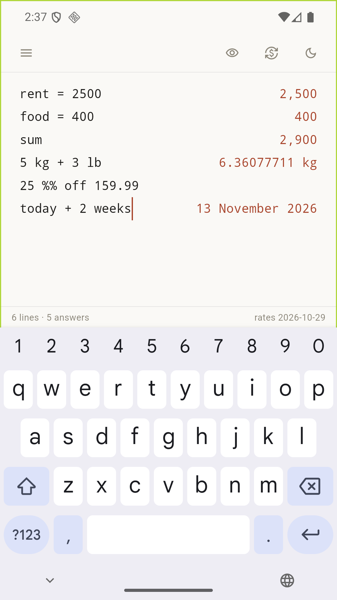

# Tallynote

**The notepad that adds up.** A Soulver/Numi-style calculator where every line of plain text is a calculation, and the answer sits quietly on the right.

Type what you mean. Tallynote parses it as you type:

```
rent = 2500                    →  2,500
food = 400                     →  400
rent + food                    →  2,900

# Trip to Tokyo
flights = 4,280                →  4,280
hotel 3 nights × 850           →  2,550
total of #trip                 →  6,830

100 USD in HKD                 →  HK$780.00
5 kg + 3 lb                    →  6.36077711 kg
25% off 159.99 + 10% tax       →  131.99175
9 is to 16 as 27 is to what    →  48
today + 2 weeks                →  13 November 2026
3pm HKT in New York            →  3:00 AM
```



Balance sheets work the same way — a `sum` per section, then one total:

```
# Assets
cash 500,000                 →  500,000
stocks 300,000               →  300,000
sum                          →  800,000

# Liabilities
mortgage -500,000            →  -500,000
cards -20,000                →  -20,000
sum                          →  -520,000

合共                          →  280,000
```

The grand total only counts individual lines, never the subtotals above it, so
nothing is counted twice.

## What it does

- **Line-by-line answers** — every line is evaluated independently; errors stay on their own line and never break the sheet.
- **Natural language** — `plus`, `times`, `15% of`, `20% off`, `is what % of`, rule of three.
- **Variables and references** — `total cost = $750`, `prev`, `line 3`. Change a value and every answer below updates.
- **Aggregates** — `sum`, `average`, `count`, `min`, `max` per section.
- **Tags and subtotals** — tag any line with `#food`, then `total of #food`.
- **Grand total** — `grand total` / `合共` / `總共` adds every answer above the line, grouped by unit (`6.36 kg, 2 m` rather than a fake single number). Lines labelled *Total / Net / 合計* are treated as summaries and never counted twice.
- **Paste-friendly** — `Topstep: −$10,408.52` keeps its label out of the way, the unicode minus keeps its sign, and money always shows cents.
- **Units** — length, mass, area, volume, speed, time, data, angle, temperature; mixed units convert automatically (`5 kg + 3 lb`).
- **Currency** — ISO codes and symbols, daily ECB rates via frankfurter.app, cached for offline use.
- **Dates and time** — calendar math, durations, timezone conversion.
- **Functions** — `sqrt`, `log`, `ln`, `sin`, `cos`, `round`, `fact`, `min`, `max`, and friends.
- **Conditionals** — `if 5 > 3 then 10 else 20`.

## Platforms

| Platform | Status |
|---|---|
| Android | built and tested |
| Linux | built in CI |
| Windows | built in CI |
| Web | runs; used for UI preview |
| macOS | project ready; not built (needs full Xcode) |

## Design notes

Paper and ink: no cards, no gradients, no chrome. Text on the left, answers right-aligned in tabular figures, one hairline rule where it helps.

- **Collapse the sidebar** with `⌘\` / `Ctrl+\`
- **Hide answers** for a clean writing surface with `⌘⇧A` / `Ctrl+Shift+A`
- Sheets, theme and rates stay on the device; nothing leaves it except the daily rate fetch.

## Build

```bash
flutter pub get
flutter test
flutter run -d macos      # or android, linux, windows, chrome
flutter build apk --release
```

## License

MIT. The notepad-calculator idea belongs to [Soulver](https://soulver.app) and [Numi](https://numi.app); Tallynote is an independent implementation that borrows the idea, not the code.
